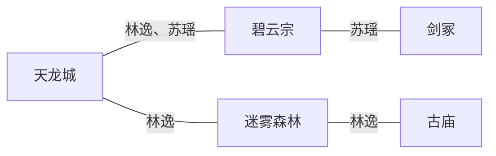

# 命令详解：其他命令

> 何时加载：更新 Mermaid 关系图时。SKILL.md「命令列表」只留一句话，这里是完整流程与判据。


## 更新图
```
更新图
更新图 [类型]
```
手动更新 Mermaid 关系图。默认自动更新，但可手动触发。

**支持的图表类型**：
- `地点`（默认）：地点关系图，展示地点之间的连接关系
- `角色`：角色关系图，展示角色之间的情感、阵营关系
- `地图`：世界地图，展示地点方位与地理连通（道路/山脉/河流/禁地）

**生成规则（地点图）**：
- 触发时机：写章节后、手动调用、新增地点时
- 节点：每个地点一个节点
- 连线：角色在两地间移动过则连线
- 标注：连线上标注移动过的角色名

**输出示例（地点关系图）**：


**生成规则（地图）**：
- 触发时机：设定扩充/新增地点后手动调用 `更新图 地图`；地图只随设定走，不随章节自动刷
- 节点：每个地点一个节点，标题含方位前缀（如「青云镇【东境·黑风山脚】」）
- 连线：**地理连通**而非角色移动——实线 `---`=通途（官道/小路/水路），虚线 `-.->`=阻隔或危险通道（山脉/瘴气/禁地/断路过不去），连通线不标角色名
- 布局：用 `graph LR` + 方位顺序排节点（西→东、北→南），大致体现相对方位；区域用 `subgraph` 分组（如东境/黑风山脉/内陆）
- 附加：图下方附「图例」段——尺度（如：青云镇到黑风山脉百里）、地形、势力范围、禁地标注
- 孤立但重要的地点（无连通线）也要入图，用注释标注存在感（如远景/回忆出现）
- **与「地理方位」表同步（2026-10-12 补）**：地图节点的相对位置/距离必须与「地理方位」表一致；新增或调整地点方位时，**两处一起改**，防漂移

**Mermaid 语法合规（2026-10-12 补，防图不渲染）**：mermaid 对中文/特殊字符很挑，写法务必照已验证样式（语雀渲染说明见手册 6.11）：
- ① 节点**必须带 id**（`A[中文标签]`），不写裸中文节点；
- ② 中文标签用 `[]` 包裹，边标注用 `|中文|`；
- ③ **不用中文 subgraph 名**（避免 `subgraph 青云宗一带`）；
- ④ 节点标签内避免 `【】（）` 等全角特殊符，需要分隔用 `·` 或空格；
- ⑤ 避开 mermaid 保留字（end／graph 等）。
- 反例（**读不出**）：`subgraph 中文` + `山门【山脚】 ---|宗内| 青云宗【青石山】`（2026-10-12 第22章实弹）。

**输出示例（世界地图）**：
```mermaid
graph LR
  subgraph 东境
    青云镇【山脚】 ---|官道三日| 青云宗【青云峰】
  end
  青云镇 -.->|黑风山脉·禁地| 黑风山脉【封印地】
```

> 图例：东境三宗共治；黑风山脉百里外，禁地；青云镇到山脉路程一日。

---
